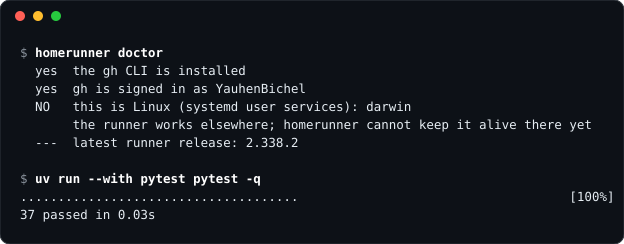

# homerunner

A command-line tool that runs the CI of your private GitHub repositories on a Linux machine you already own, so you stop paying for or waiting on GitHub Actions minutes. One command per repository, and it refuses to register a runner on a public repository.



The picture is real output, captured on macOS, where `doctor` correctly says that this machine cannot keep a runner alive. Registering a runner needs Linux with systemd and a signed-in `gh`, so it was not run for the picture. The sample output further down shows what `add` prints on Linux. The same text:

```console
$ homerunner doctor
  yes  the gh CLI is installed
  yes  gh is signed in as YauhenBichel
  NO   this is Linux (systemd user services): darwin
       the runner works elsewhere; homerunner cannot keep it alive there yet
  ---  latest runner release: 2.338.2

$ uv run --with pytest pytest -q
.....................................                                    [100%]
37 passed in 0.03s
```

[](https://github.com/YauhenBichel/homerunner/actions/workflows/tests.yml)
[](LICENSE)

GitHub Actions minutes are free on public repositories and metered on private ones. When the quota
runs out, every job fails before it runs a step — `steps=0`, which looks like a broken build and
isn't one. Meanwhile there is a perfectly good machine under your desk doing nothing between tasks.

## Quick start

homerunner is not on PyPI yet, so install it from GitHub. You need Python 3.10 or newer, Linux with systemd, and the [`gh` CLI](https://cli.github.com) signed in (`gh auth login`).

```bash
uv tool install git+https://github.com/YauhenBichel/homerunner   # or: pip install git+https://github.com/YauhenBichel/homerunner
homerunner doctor                                                  # can this machine host a runner?
homerunner add YOUR-NAME/your-private-repo
```

Expected: `doctor` lists what is missing, with the fix for each line. `add` registers a runner for that repository, installs a user service that keeps it alive, and tells you what to put in the workflow:

```
  runner 2.337.0 -> /home/you/.local/share/homerunner/you-your-private-repo
  labels: self-hosted, myhost
  service homerunner-you-your-private-repo: active

Point a workflow at it:

  runs-on: [self-hosted, myhost]
```

## The refusal

```console
$ homerunner add YauhenBichel/moe-fit
homerunner: YauhenBichel/moe-fit is public. A self-hosted runner on a public repository runs code
from anyone's pull request on this machine, with your files and your keys. Use a hosted runner, or
pass --i-know-this-is-public if this machine is disposable.
```

This is the feature. A self-hosted runner on a public repository will execute whatever a stranger
puts in a pull request, on the machine it runs on — your keys, your home directory, your models.
GitHub documents it; people do it anyway, because nothing stops them at the moment it happens.
`homerunner` stops them at exactly that moment.

## What it decides for you

- **One runner per repository, scoped to that repository.** Not one account-wide credential that
  could build anything you own.
- **`Nice=15` and `IOSchedulingClass=idle`.** CI yields to whatever the machine is really for. On
  the box this was written for, that is a 52 GB model; a test run waits its turn.
- **`KillMode=process`**, so a job in flight finishes rather than being killed mid-write.
- **A user service**, so no root is needed, and a warning if lingering is off — without it your
  runner stops when you log out.
- **No token of its own.** Everything that needs credentials goes through the `gh` CLI you have
  already signed in. The registration token it fetches lives for an hour and never reaches disk.
  There is nothing here worth stealing.

## When to use it

- You have private repositories, your Actions minutes ran out (or you want to save them), and a Linux box that is idle most of the day.
- You want CI that waits for the machine's real job (low CPU and disk priority) and starts again after a reboot.

## When not to use it

- Public repositories. Hosted runners are free there, and a self-hosted runner would run strangers' code on your machine.
- Many machines or autoscaling. Use Actions Runner Controller.
- macOS or Windows. The runner works there, but homerunner cannot keep it alive yet.

## FAQ

### How do I run GitHub Actions on my own server for a private repository?

Run `homerunner add owner/repo`, then set `runs-on: [self-hosted, <label>]` in the workflow. The label is printed by `add`.

### Why does every job fail with steps=0?

That is what private repositories show when the Actions minutes quota is used up. The job is refused before it runs a step. A self-hosted runner does not use the quota.

### Does it send my data anywhere?

It sends nothing of its own. It calls the `gh` CLI to read the repository's visibility and to fetch a registration token, and it downloads the official GitHub runner release. Your workflows then talk to GitHub as any runner does. It stores no token.

### How do I remove a runner?

`homerunner remove owner/repo`, and add `--purge` to delete its files.

### How is it different from setting up a runner by hand, or from Actions Runner Controller?

By hand you download the runner, register it, write a service file and remember the safety rules. This does those steps and refuses the public-repository mistake. Actions Runner Controller autoscales runners on Kubernetes; this is for one machine.

## Commands

```bash
homerunner add <owner/repo>     # register, install, start
homerunner list                 # what this machine runs, and what GitHub thinks of it
homerunner remove <owner/repo>  # deregister and take the service away (--purge deletes the files)
homerunner doctor               # can this machine host a runner at all?
```

`doctor` first, always:

```console
$ homerunner doctor
  yes  the gh CLI is installed
  NO   gh is signed in
       gh auth login
  yes  this is Linux (systemd user services): linux
  yes  systemctl is available
  yes  user services survive logout (lingering)
```

Useful flags: `--ephemeral` (the runner takes one job and exits, which is the safest shape),
`--label gpu` (extra labels a workflow can target), `--nice` and `--io-class` if the defaults are
too polite, `--runner-version` to pin.

## What it is not

- **Not an autoscaler.** [Actions Runner Controller](https://github.com/actions/actions-runner-controller)
  does that on Kubernetes, and does it properly. This is for one machine you can touch.
- **Not isolation.** An ephemeral runner gets a clean workspace, not a clean machine. If you need
  the job in a sandbox, run the job in a container, or use a VM-based tool such as
  [SHER](https://github.com/pranau97/sher).
- **Not a way to make a public repository cheap.** See the refusal above.
- **Linux only, today.** The runner itself works on macOS; keeping it alive there needs launchd,
  which is not written yet. `doctor` says so rather than pretending.

## Requirements

Linux with systemd, Python 3.10+, and the [`gh` CLI](https://cli.github.com) signed in with admin
on the repositories you point it at. No other dependencies.

## Contributing

Issues and pull requests welcome — see [CONTRIBUTING.md](CONTRIBUTING.md). The tests replace
`subprocess.run`, so the whole suite runs in well under a second with no network, no `gh` and no
runner:

```bash
uv run pytest -q
```

## Contributors

Thank you to everyone who has helped.

<!-- readme: contributors,bots/- -start -->
<p align="center">
  <a href="https://github.com/YauhenBichel" title="Yauhen Bichel" aria-label="Yauhen Bichel"></a>
</p>
<!-- readme: contributors,bots/- -end -->

## Licence

Apache-2.0. See [LICENSE](LICENSE).
